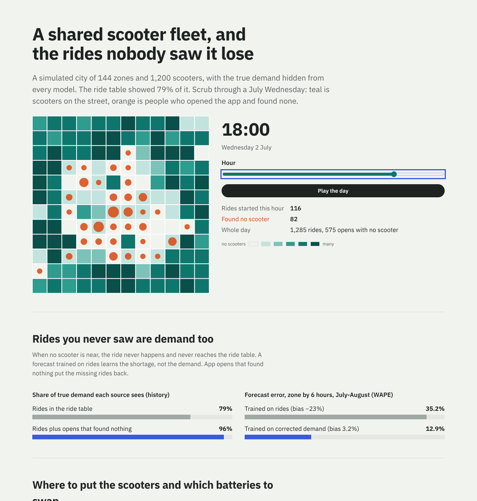

# micromobility-decision-engine

The ML and experiments behind a shared e-scooter fleet, built in a simulated city where the true demand,
price sensitivity and road surfaces are known to the evaluation and hidden from every model:

- **Operations**: zone-hour demand forecasts that correct for **censored demand** (the rides that never
  happened because no scooter was near), feeding a deployment and battery-swap planner.
- **Pricing**: price tests on a shared fleet, where a rider-level A/B test is biased by interference and a
  **switchback** is not, and a time-band price policy.
- **Causal inference**: a **difference in differences** for a competitor launch nobody randomised.
- **Safety from sensors**: a PyTorch model on the deck's IMU for **sidewalk riding** and **two people on one
  scooter**, run as int8 ONNX on the scooter.

Each part is scored on a dev city, released or held by a gate, and then run once on a held-out city and a
held-out scooter generation.



## Results

Every number is generated by `make report` from `reports/`. Operations run July and August (62 days) three
times with the same people under each policy, paired by day.

### Censored demand

| | Dev city | Held-out city |
|---|---|---|
| Share of true demand in the ride table | 79.1% | 77.0% |
| Share recovered by counting app opens that found no scooter | 95.8% | 95.2% |
| Forecast WAPE, zone × 6 h, trained on rides | 35.2% (bias −23.4%) | 35.9% (bias −27.4%) |
| Forecast WAPE, trained on corrected demand | **12.9%** (bias +3.2%) | **12.3%** (bias +0.1%) |

### Operations (80 swaps and 130 moves a day)

| Policy | Dev: € per day vs status quo (95%) | Held-out: € per day vs status quo (95%) |
|---|---|---|
| Status quo: emptiest batteries, last fortnight's ride starts | 4,607 € a day | 4,872 € a day |
| Planner on the ride table (censored) | −51 (−67 to −37) | −38 (−50 to −23) |
| Planner on corrected demand | +11 (−5 to +25) | +21 (+11 to +33) |
| Planner with perfect demand (reference) | +26 (+12 to +37) | +25 (+15 to +37) |

The gate held the planner: on dev its interval crossed zero, and even a perfect forecast buys under 1% with
crews this lean. What it shows is the cost of the censored forecast: a planner trained on the ride table
**loses 38-51 € a day** against the heuristic it was meant to replace.

### Price experiments (dev, ten four-week experiments, +20% price everywhere)

The true effect is **+509 € a day (+10.7%)**.

| Design | Bias € per day | Spread € per day | RMSE € per day |
|---|---|---|---|
| Rider-level A/B test | **−130 (−25%)**, low in 10 of 10 | 49 | 136 |
| City-wide switchback, 2 h windows, day and hour fixed effects | **−10 (−2%)** | 200 | 199 |

Riders in a test share scooters: when the expensive group rides less, the cheap group finds more scooters,
so the A/B test understates what a city-wide price does. The switchback is unbiased but four weeks is too
short for it. Adjusting for app opens to cut its noise biased it by −28%, because the price changes who
finds a scooter ([decisions](docs/decisions.md)).

A four-level elasticity switchback chose **1.15× at weekends** (other bands stay at 1.0× under a floor of 92%
of base rides). True uplift **+1.9%** of contribution with 2% fewer rides, in both cities. A switchback could
not confirm it (−177 € to +284 € a day across three runs), so it is held.

### Competitor launch (difference in differences; truth −18%)

| Outcome | Before vs after | Difference in differences (95%) |
|---|---|---|
| Rides (capped by the fleet) | −0.5% | −11.4% (−15.2% to −7.1%) |
| Corrected demand | −3.0% | **−15.9% (−18.7% to −12.6%)** |

June's growth hides the loss in a simple before-and-after; rides understate it because the fleet caps them.

### Sidewalk and two-up riding from the IMU

| | Dev-test, gen6 | Held-out, gen7 scooter, other city |
|---|---|---|
| Sidewalk stretches (≥ 10 s) slowed down | **91.0%** | 67.7% |
| Median time to slow down | 6 s | 10 s |
| False slowdowns per 100 km of legal riding | **0.0** (272 km) | 0.0 (274 km) |
| Sidewalk window precision / recall | 96.5% / 81.9% | 86.0% / 64.8% |
| Two riders: precision / recall | 90.2% / 90.3% | 92.1% / 88.4% |

45k parameters; int8 ONNX **56 kB**, 0.06 ms per 2-second window on one CPU thread, 99.8% of windows classified
like the float model. A fifth of sidewalks are smooth asphalt, which vibration cannot separate from road.
The gen7 drop is what a new scooter generation costs without recalibrating the threshold
([SKILLS.md](SKILLS.md)).

### Gate (dev city, `config/gate.toml`)

| Component | Decision |
|---|---|
| Demand forecast on corrected demand | ship |
| Operations planner | hold: keep the heuristic |
| Price experiment design | switchback |
| Weekend price policy | hold: run the switchback longer |
| Sidewalk and two-up model | ship |

## How it works

```
src/mde/world      the simulated world (hidden truth): zones, intents per zone-hour, weather, a competitor,
                   price acceptance by rider type, trips and batteries; the IMU of two scooter generations
src/mde/demand     censoring correction from app opens; LightGBM zone-hour forecast; the online call
src/mde/ops        status-quo heuristic and the planner (need = peak of cumulative demand minus arrivals,
                   value of the k-th scooter = margin x P(need >= k))
src/mde/pricing    rider A/B and switchback assignment and estimators (day and hour fixed effects), band policy
src/mde/causal     difference in differences with zone-clustered bootstrap and an event study
src/mde/sensing    1-D CNN with surface and two-rider heads, hardware randomisation, training
src/mde/evals      the only code allowed to read the truth: oracle demand, block bootstrap
scripts/           ops_eval, pricing_eval, causal_eval, sensing_eval (ONNX + int8), gate, heldout, report
web/               dashboard: React, Framer Motion, every state (loading, error with retry, empty)
```

## Run it

```bash
pip install torch --index-url https://download.pytorch.org/whl/cpu && pip install -e ".[dev]"
make test                                   # 13 tests in seconds
make ops pricing causal sensing gate        # about 20 minutes on two cores
make heldout                                # once
make report && cd web && npm ci && npm run dev
```

## Limits

- Simulated: one city layout per split, a gravity model for trips, synthetic IMU. The methods transfer; the
  sizes of the numbers do not.
- No camera or image model. Parking compliance from end-of-ride photos is the obvious next part.
- The planner works per shift with a fluid view of scooter flows; a stochastic or RL planner might find the
  room a perfect forecast shows is small here.

No Bolt data or code was used.
